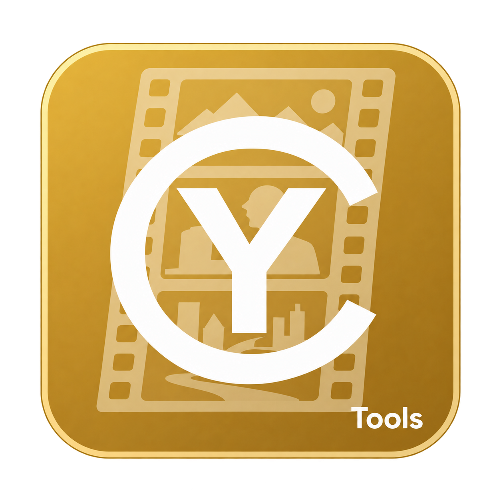
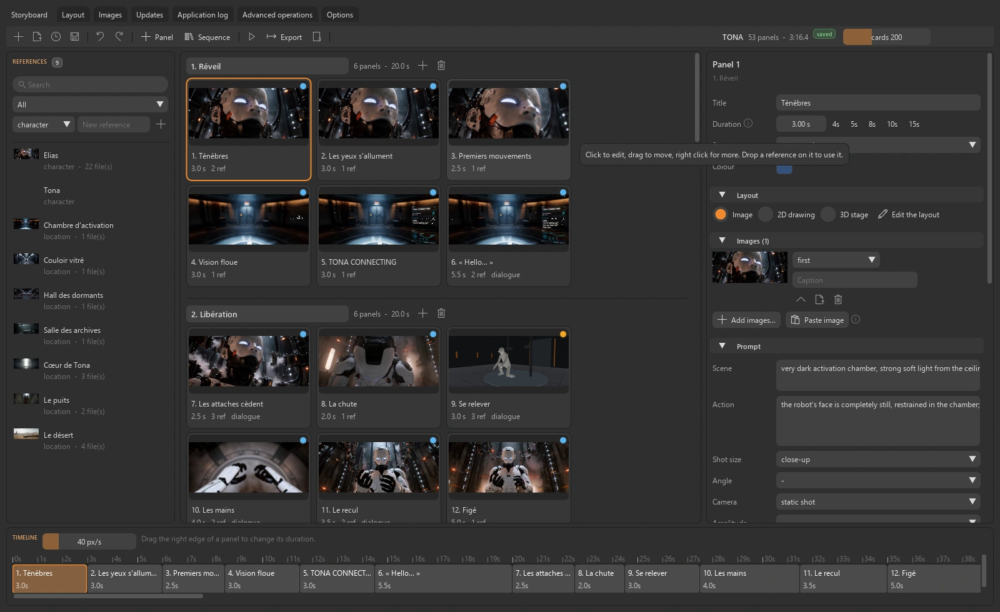
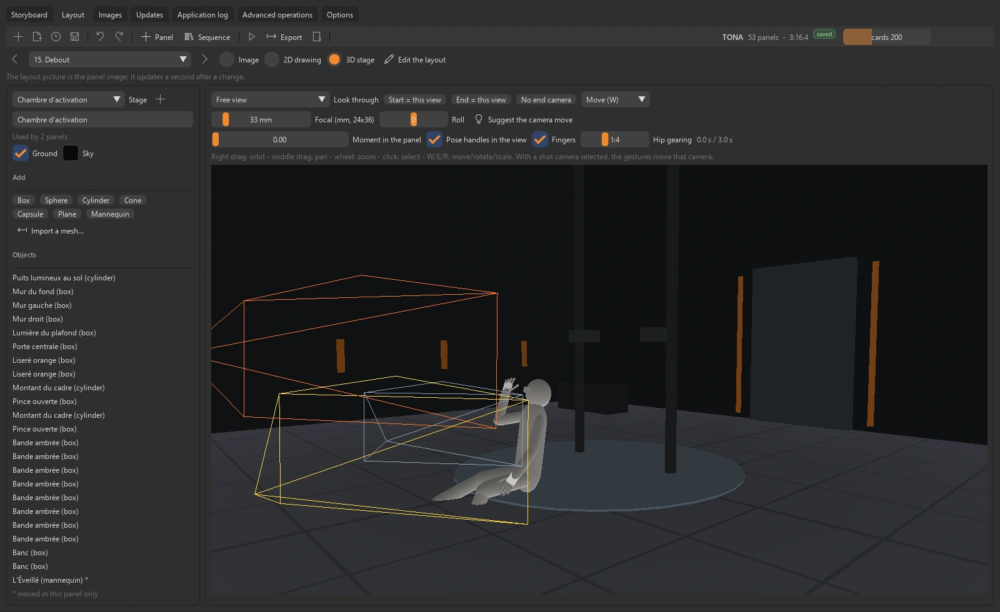
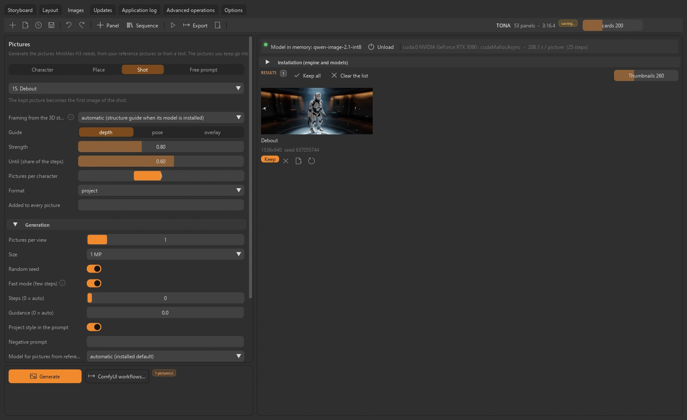

<table width="100%">
  <tr>
    <td width="300" align="left" valign="top">
      <a href="https://mrmybal.github.io/CyTools_Storyboard/?lang=fr">Site web</a><br>
      <a href="https://mrmybal.github.io/CyTools_Storyboard/Documentation.html#/fr/overview">Documentation</a><br>
      <a href="https://github.com/MrMybal/CyTools_Storyboard">GitHub</a><br><br>
      <sub>README</sub><br>
      <a href="README.md">English</a> · <a href="README.fr.md">Français</a>
    </td>
    <td width="400" align="center" valign="middle">
      <a href="https://mrmybal.github.io/CyTools_Storyboard/?lang=fr"></a>
    </td>
    <td width="300" align="right" valign="top">
      <p><sub>Licence de l’application</sub><br><a href="LICENSE"><strong>GPL-3.0-only</strong></a></p>
      <p><sub>Version de l’application</sub><br><a href="VERSION.fr.md"><strong>0.2.3</strong></a><br><strong>EXPÉRIMENTAL</strong></p>
      <p><a href="https://github.com/MrMybal/CyTools_Storyboard/releases/download/v0.2.3/CyTools_Storyboard-0.2.3-windows-x64.zip"><strong>Télécharger</strong></a><br><sub>Windows x64 · portable</sub></p>
    </td>
  </tr>
</table>

<h1 align="center">CyTools Storyboard</h1>


Organisez les cases dans le temps, préparez la caméra et mettez en scène en 3D. Retrouvez références et dialogues dans les images, animatiques et workflows compatibles. Pour les réalisateurs, les storyboarders et les créateurs qui préparent un film ou une séquence générée.

> **EXPÉRIMENTAL · 0.2.3**
>
> Version Windows publiée pour évaluation ; certains parcours des moteurs restent à valider. Consultez les [notes de version et limites connues](VERSION.fr.md).

[](website/assets/showcase/board.webp)

*Storyboard · références, cases minutées, inspecteur et timeline.*


## L’application

### Cases et durée

Organisez les cases en séquences, réglez durées et transitions et gardez les notes près de l’image. Chaque case peut contenir dialogues, action, caméra et indications sonores.

### Mise en scène 3D

Mettez les plans en scène avec formes, maillages et mannequins articulés. Réglez caméras, positions de départ et d’arrivée et poses, puis réutilisez le décor dans plusieurs cases.

[](website/assets/showcase/layout.webp)

*Espace Layout · mannequin, décor partagé et caméras.*


### Images de référence

Importez des références ou préparez les images avec un workflow Qwen-Image compatible. La génération passe par un moteur ComfyUI privé ou un ComfyUI externe configuré. La recette accompagne chaque image conservée.

[](website/assets/showcase/images.webp)

*Espace Images · image de plan et réglages de génération.*


## Fonctionnalités

- **Storyboard :** cases minutées, séquences, transitions, inspecteur, annulation/rétablissement et sauvegarde automatique.
- **Direction des plans :** action, cadrage, objectifs, caméra, dialogues, interprétation, notes sonores/musicales et références liées.
- **Mise en scène :** décors 3D partagés, maillages, mannequins articulés, caméras, poses et mouvements ; le dessin 2D est également disponible.
- **Images :** import ou génération Qwen-Image/ComfyUI compatible, avec conservation des recettes des images retenues.
- **Exports :** planches contact, scripts, animatiques, transferts de films MiniMax H3 et workflows CyTools_MiniMaxH3. L’inférence H3 appartient à l’application destinataire.

**Application et automatisation :** l’anglais est la langue par défaut ; le français se choisit dans Options. Enregistrez/chargez les configurations, consultez les journaux copiables et utilisez les opérations déclarées par CLI ou MCP. Le [manuel](https://mrmybal.github.io/CyTools_Storyboard/Documentation.html#/fr/overview) décrit les paramètres et contrats de sortie réels.

---

## Installation

La version applicative publiée est pour **Windows x64**. Le ZIP portable inclut son Python privé et les dépendances de base de l’interface et des médias. Les modèles et moteurs lourds facultatifs se téléchargent séparément.

1. [Téléchargez CyTools Storyboard 0.2.3](https://github.com/MrMybal/CyTools_Storyboard/releases/download/v0.2.3/CyTools_Storyboard-0.2.3-windows-x64.zip).
2. Extrayez le ZIP complet dans un dossier accessible en écriture. Gardez `app/` et `runtime/` à côté du lanceur.
3. Lancez **CyTools_Storyboard.exe**. Utilisez l’espace d’installation/modèles pour les composants nécessaires ; consultez leurs licences et conditions d’accès avant le téléchargement.

Aucun Python système n’est nécessaire pour ouvrir le portable. L’installation depuis les sources et certains moteurs facultatifs nécessitent des outils supplémentaires comme Git. Conservez le dossier complet ; l’exécutable seul ou le ZIP de mise à jour `app` ne constitue pas une installation complète.

Application Windows x64 expérimentale ; Linux n’est pas validé. La vue 3D nécessite OpenGL 3.3. La génération d’images locale demande un moteur GPU compatible et ses poids. L’export H3 prépare un transfert ; cette application n’exécute pas elle-même l’inférence MiniMax H3. Les licences Qwen-Image varient, avec des variantes non commerciales.

### Mises à jour et données

Pour une installation compatible existante, utilisez Mises à jour et le paquet applicatif correspondant. Préservez `data/`, les moteurs et les modèles. Ne forcez pas une mise à jour destinée à un autre ABI. Si le runtime requis change, installez le portable complet dans un dossier séparé et suivez la migration.

## Sources, compilation et bibliothèques nécessaires

<details>
<summary>Installation des sources Windows et outils de compilation facultatifs</summary>


Utilisez Python **3.11** pour l’environnement de base depuis les sources. Git sert au clonage et aux dépendances Git épinglées. Compiler le lanceur nécessite les Build Tools MSVC x64 et une invite développeur.

```powershell
git clone https://github.com/MrMybal/CyTools_Storyboard.git
cd CyTools_Storyboard
py -3.11 -m venv runtime\python
runtime\python\Scripts\python.exe -m pip install "cytools-core[mcp] @ git+https://github.com/MrMybal/CyToolsCore.git@a8d200f2d0baaade1633e0683663b4506c595f74"
runtime\python\Scripts\python.exe -m pip install -r app\requirements.txt
powershell -File app\build_launcher.ps1
.\CyTools_Storyboard.exe
```

Les dépendances de base exactes sont dans [app/requirements.txt](app/requirements.txt). Les moteurs utilisent leurs propres environnements et catalogues ; installer la base ne les installe pas. Consultez le [guide développeur](app/README.md) pour la compilation détaillée et les composants facultatifs.

</details>

---

## Licence

**CyTools Storyboard utilise la licence [GPL-3.0-only](LICENSE).** CyToolsCore, CyUI et CyDoc restent des composants MIT ; leurs licences ne changent pas celle de l’application. Moteurs, plugins et poids conservent leurs propres conditions.

### Principaux composants et bibliothèques tierces

| Bibliothèque · sources | Licence · texte | Utilisation / périmètre |
| --- | --- | --- |
| [CyToolsCore 0.10.1](https://github.com/MrMybal/CyToolsCore) | [MIT](LICENCES/CyToolsCore-MIT.txt) | SDK/runtime : jobs, sessions, ressources, CLI et MCP. |
| [CyUI 1.2.0](https://github.com/MrMybal/CyUI) | [MIT](LICENCES/CyUI-MIT.txt) | Modules Python d’interface sélectionnés et inclus. |
| [CyDoc 0.1.0](https://github.com/MrMybal/CyDoc) | [MIT](LICENCES/CyDoc-MIT.txt) | Lecteur local inclus ; Node/npm servent uniquement à la rédaction/génération. |
| [Dear ImGui / imgui-bundle](https://github.com/pthom/imgui_bundle) | [MIT + notices des composants](https://github.com/pthom/imgui_bundle/blob/main/LICENSE) | Rendu de l’interface et composants natifs inclus. |
| [CPython 3.11](https://www.python.org/) | [PSF + notices des composants](https://docs.python.org/3.11/license.html) | Runtime privé inclus dans l’archive Windows portable. |
| [ModernGL / glcontext / trimesh](app/requirements.txt) | [MIT](LICENCES/SOURCES.txt) | Mise en scène 3D, viewport et maillages. |
| [NumPy / Pillow](app/requirements.txt) | [BSD-3-Clause / MIT-CMU](LICENCES/SOURCES.txt) | Tableaux et rendu d’images. |
| [imageio / imageio-ffmpeg / FFmpeg](https://github.com/imageio/imageio-ffmpeg) | [BSD-2-Clause; FFmpeg inclus GPL-3.0](LICENCES/SOURCES.txt) | Vidéos de contrôle/animation et animatiques ; conserver les notices du build FFmpeg. |
| [ComfyUI / PyTorch](app/engines.json) | [GPL-3.0 / BSD-3-Clause](LICENCES/SOURCES.txt) | Moteur d’images facultatif téléchargé. Conditions de recherche ou Apache selon le modèle Qwen-Image. |

Ce tableau indexe les principaux composants sans remplacer leurs notices transitives complètes. Conservez [LICENCES/](LICENCES/), [app/licenses.json](app/licenses.json), les licences des paquets installés et celles de chaque moteur/modèle facultatif. Les bibliothèques CUDA installées conservent aussi les conditions NVIDIA.

## Références et liens

- [Documentation](https://mrmybal.github.io/CyTools_Storyboard/Documentation.html#/fr/overview)
- [Site web](https://mrmybal.github.io/CyTools_Storyboard/?lang=fr)
- [Dépôt des sources](https://github.com/MrMybal/CyTools_Storyboard) · [Releases et sommes de contrôle](https://github.com/MrMybal/CyTools_Storyboard/releases)
- [Suivi des problèmes](https://github.com/MrMybal/CyTools_Storyboard/issues) · [Notes de version](VERSION.fr.md)
- [Guide développeur](app/README.md)

<details>
<summary><strong>AI Usage</strong></summary>

- [Commencer ici : guide IA du projet](app/AGENTS.md) — règles du produit et fichiers importants.
- [Opérations et intégration IA](app/Documentation/DocAI.md) — contrats réels et utilisation en tâches.
- [Compiler cette application](app/README.md) — installation des sources et commandes propres au produit.

</details>
