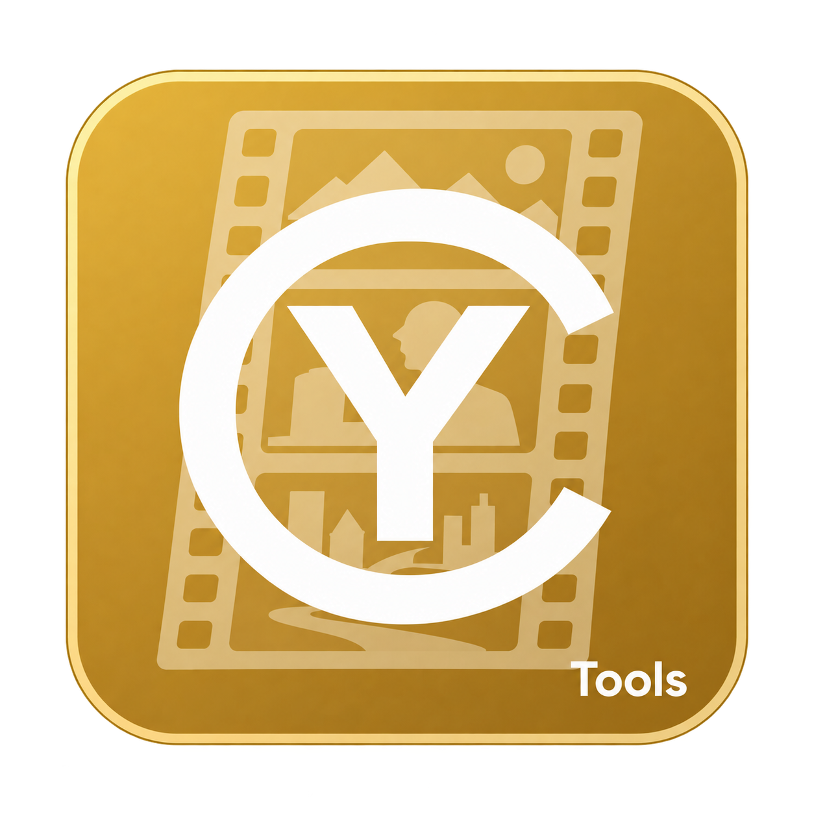
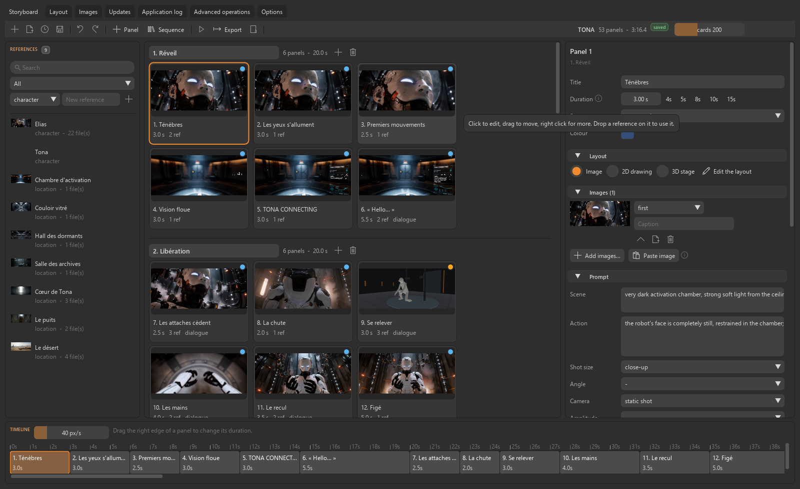
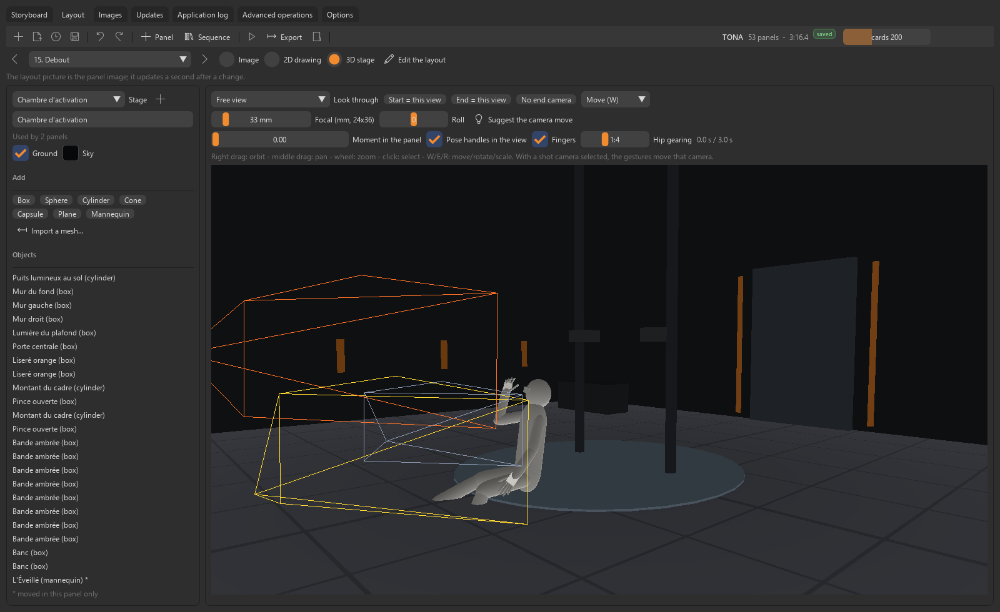
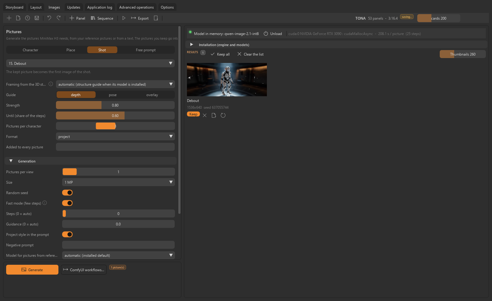

# CyTools Storyboard

<p align="center">
  
</p>

A standalone storyboard and previs application for generated films (Windows desktop application,
command line and MCP server on one runtime), built on the
[CyToolsCore](https://github.com/MrMybal/CyToolsCore) SDK. French user guide:
[LISEZ-MOI.md](LISEZ-MOI.md). Developer guide: [app/README.md](app/README.md).

It is where a film is edited before it is generated: shots, timing, references, staging and
camera, then exported for **MiniMax H3** — as a film read by the
[ComfyUI-CyTools-H3Film](https://github.com/MrMybal/ComfyUI-CyTools-H3Film) nodes, or as a
workflow for CyTools_MiniMaxH3.

## Version 0.2.1

The desktop interface uses CyUI for the toolbar, reference library, board, inspector,
Images and Layout pages, and export dialogs. Options adds five themes and compact or
comfortable density. Existing projects, CLI and MCP operations remain compatible.

## Screenshots


*Storyboard: reference library, board of panels, inspector and timeline.*


*Layout: a panel staged on a shared 3D set, with a posed mannequin and the shot cameras.*


*Images: the picture of a shot generated by Qwen-Image from its 3D staging (depth guide).*

## What it does

- **Board and timeline**: sequences of timed panels with drag and drop, duration handles,
  transitions (cut, crossfade, fades), undo / redo, autosave, status and colours.
- **Structured prompts per panel**: scene, action, shot size, angle, camera move with amplitude
  and speed, lens, dialogue lines per character (language, delivery, off-screen), sound, music.
- **Reference library**: characters, locations, objects, styles, pictures, sounds and videos,
  linked to the panels that use them; a character's audio file is its voice.
- **Staging**: panels framed on shared **3D sets** of simple shapes, meshes and posable
  mannequins (orbit / pan / zoom, gizmos, shot cameras with a start and an end), or drawn in
  **2D**. Characters walk along their moves, change pose during a shot and are posed joint by
  joint or directly in the view with handles on the hands, fingers, wrists, elbows, shoulders,
  head, neck, pelvis, hips, knees, feet and toes (inverse kinematics, joint limits).
- **Exports**: contact sheet (PNG), script (HTML or Markdown), animatic (MP4 with captions; 3D
  panels play their camera and character moves).
- **Reference pictures generated in the application** (Images tab): views of a character or a
  place from its reference pictures (or from its description), a character placed in a place, the
  picture of a shot from its staging render, or a free prompt. Rendered by **Qwen-Image** on a
  private ComfyUI engine that keeps the model loaded between pictures; every picture kept in the
  project carries its recipe. The same graphs are exported as ComfyUI workflows.
- **MiniMax H3 film**: the panels of a sequence grouped into H3 segments of about 20 s (or one
  segment per panel) on the 5 + 17n frame grid, overlap where the picture continues, pictures,
  reference videos and sounds per segment, editable prompt sentences,
  optional depth or OpenPose control videos (with hands and feet) rendered from the 3D staging,
  and a ComfyUI workflow written next to the film.
- **MiniMax H3 workflow**: the storyboard as a CyTools_MiniMaxH3 workflow (one generation per
  panel, trims and transitions, final edit).

## Requirements

- Windows 10/11 x64 (the Linux launcher is provided but has not been run on Linux).
- Python 3.11 and `git` on the PATH to build the private environment.
- An OpenGL 3.3 capable GPU or driver for the 3D view and renders.
- Optional, for the Images tab: an NVIDIA GPU (24 GB of VRAM for the models as shipped) with a
  driver supporting CUDA 13, about 8 GB of disk for the image engine and 17 to 31 GB per model.
  Without it, the same pictures can be rendered on another ComfyUI (its address in the tab).

## Installation

From the Tool folder:

```
py -3.11 -m venv runtime\python
runtime\python\Scripts\python.exe -m pip install "cytools-core[mcp] @ git+https://github.com/MrMybal/CyToolsCore.git@a8d200f2d0baaade1633e0683663b4506c595f74"
runtime\python\Scripts\python.exe -m pip install -r app\requirements.txt
powershell -File app\build_launcher.ps1
```

Then double-click `CyTools_Storyboard.exe`.

## Image engine and models

Nothing heavy ships with the application. From the Images tab (Installation), or from the
command line:

```
runtime\python\Scripts\python.exe app\setup_engine.py image
runtime\python\Scripts\python.exe app\tool.py invoke install_image_model --params "{\"model\":\"qwen-image-2.1-int8\"}"
```

(the second command needs a client with the `network` permission: `tool.py create-client --name me
--permission network`, then `CYTOOLS_TOKEN`). The engine is a private Python environment with
PyTorch (CUDA 13) in `runtime/engines/image` and a pinned ComfyUI checkout in
`runtime/sources/ComfyUI`; models go to `data/models/comfyui/`.

| Model | Use | Download | Licence |
| --- | --- | --- | --- |
| Qwen-Image 2.1 (int8), default | text-to-image and up to 10 reference pictures | 17.3 GB | Qwen Research License (non-commercial) |
| Qwen-Image 2.1 ControlNet (int8) | structure guide of shots (depth or pose of the 3D staging) | 3.8 GB | Qwen Research License (non-commercial) |
| Qwen-Image-Edit 2511 (int8) | 1 to 3 reference pictures, 4-step LoRA | 31.0 GB | Apache-2.0 |
| Qwen-Image 2512 (fp8) | text-to-image, 4-step LoRA | 30.9 GB | Apache-2.0 |

ComfyUI is GPL-3.0; it is downloaded at installation and never redistributed with this repository.

## Command line and MCP

```
runtime\python\Scripts\python.exe app\tool.py describe
runtime\python\Scripts\python.exe app\tool.py invoke export_h3_film --params-file params.json
```

Every operation (storyboards, panels, library, stages and objects, poses, renders, exports) is
declared in `app/CyTool.json` and reachable through the CLI and MCP transports of CyToolsCore.

## Layout

| Path | Content |
| --- | --- |
| `CyTools_Storyboard.exe`, `CyTools_Storyboard.sh` | launchers (the exe is built by `app/build_launcher.ps1`) |
| `app/` | code, manifest, interface, locales, tests and scripts |
| `data/` | projects, settings, logs, reports and model weights — created locally, never committed |
| `runtime/` | the private Python environments and the ComfyUI checkout — created locally, never committed |

## Tests

```
cd app
..\runtime\python\Scripts\python.exe -m unittest discover -s tests
..\runtime\python\Scripts\python.exe tests\mcp_check.py
```

## Updates and rollback

The Updates tab installs a new application release from GitHub (the `cytools-app.zip` stream:
`app/` only), checks it before activating it, never touches `data/`, and keeps the previous
version for a rollback. Version 0.2.0 moves the SDK from CyToolsCore 0.9.0 (GPL-3.0) to 0.10.1
(MIT): the portable build ships the 0.10.1 package, `LICENCES/` and `app/LICENSE-CyToolsCore.txt`.
To return to 0.1.0, use the rollback of the Updates tab, or reinstall the 0.1.0 portable build;
projects in `data/projects` open in both versions.

## License

The application's own code is GPL-3.0-only — see [LICENSE](LICENSE). It runs on the
[CyToolsCore](https://github.com/MrMybal/CyToolsCore) SDK 0.10.1, licensed under MIT
([LICENCES/CyToolsCore-MIT.txt](LICENCES/CyToolsCore-MIT.txt)).
Its interface uses CyUI, a themed layer over Dear ImGui (MIT, vendored as `app/cyui.py`,
[LICENCES/CyUI-MIT.txt](LICENCES/CyUI-MIT.txt)).
[LICENCES/SOURCES.txt](LICENCES/SOURCES.txt) lists every component the application contains or
downloads (Python packages of the portable build, FFmpeg, the image engine, the models), with its
licence and source. Generated media and model weights are not part of this repository; each model
follows its own licence.

Maintained by Cyberalien.

## Modular interface

CyUI 1.2.0 provides the selected shared interface modules. See [integration and maintenance](app/Docs/CyUIMigration.md) for the module map, preserved application behavior and validation limits.

CyUI: MIT ([upstream license](https://github.com/MrMybal/CyUI/blob/main/LICENSE)); the complete text is included in LICENCES/CyUI-MIT.txt.
